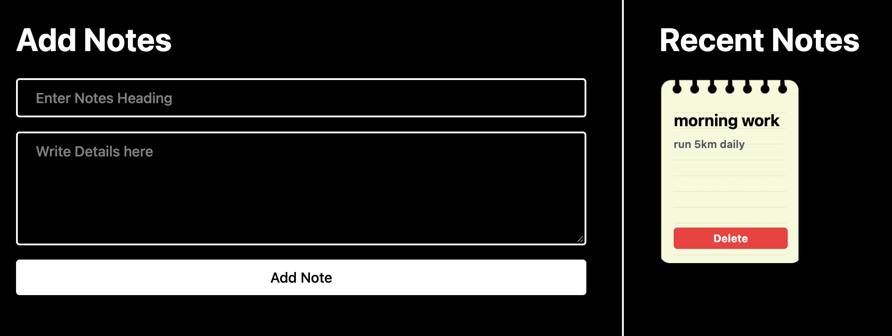

# 📝 Notes App

A simple and responsive Notes App built using **React.js**, **JavaScript**, and **CSS**. It provides a clean interface to add notes and view recent notes in a sticky-note style layout.

## 📸 Project Screenshot



## ✨ Features

- **Add Notes:** Add a note with a heading and detailed description.
- **Recent Notes:** View notes in a card-based layout.
- **Delete Notes:** Remove notes when they are no longer needed.
- **Minimal UI:** Dark background with light sticky-note cards.
- **Vite Development Server:** Fast local development and hot reloading.

## 🛠️ Tech Stack

- React.js
- JavaScript
- CSS
- Vite

## 🚀 Getting Started

### Prerequisites

- [Node.js](https://nodejs.org/)
- npm

### Installation

1. Clone the repository:

   ```bash
   git clone https://github.com/garvityadav001/Notes-app.git
   ```

2. Open the project folder:

   ```bash
   cd Notes-app
   ```

3. Install dependencies:

   ```bash
   npm install
   ```

4. Start the development server:

   ```bash
   npm run dev
   ```

5. Open the local URL shown in your terminal.

## 👨‍💻 Author

**Garvit Yadav**  
GitHub: [@garvityadav001](https://github.com/garvityadav001)
